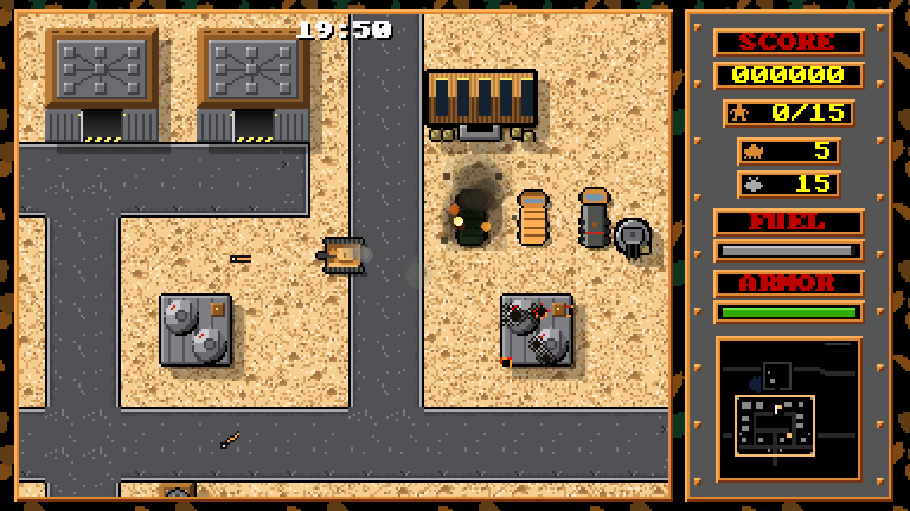

# OpenFP 0.1

An open-source remake of **Fire Power**, the 1987 Amiga tank game. Capture the
flag, rescue soldiers and break through enemy bases, solo or with friends.
Classic follows the original style of play; seven enhanced worlds add their
own vehicles, weather and battlefield features.



[Website and downloads](https://openfp.retrocs.org/play/) ·
[GitHub](https://github.com/retrocs-org/openfp) ·
[First-release features](CHANGELOG.md)

## Play

- **Clients:** macOS, Windows, Linux and native 16-colour AmigaOS.
- **Local play:** up to four players on desktop, two on AmigaOS.
- **Online:** up to eight tanks, including bots, with a dedicated server, team
  lobbies, chat, spectators and reconnect support.
- **Worlds:** Classic, Moon Base, Winter, Desert, Jungle, Swamp, Volcano and Wasteland.
- **Modes:** Classic, Capture the Flag, Conquest, Hardpoint, Team Deathmatch,
  Kill Confirmed, Annihilation and Warlord.
- **Tools:** map editors, playability checks, replays, training and a benchmark.

Download published builds from the [website](https://openfp.retrocs.org/play/).
Platforms without a published package are marked **not released yet**.
AmigaOS requires a 68040 or 68060, AmigaOS 3.x, 2 MB Chip RAM and at least
8 MB Fast RAM. Apple TV is an experimental build preview.

| Desktop controls | Player 1 | Player 2 |
| --- | --- | --- |
| Drive and turn | Arrow keys | W A S D |
| Fire | `.` | Space |
| Lay mine | `,` | E |

Keyboard bindings and controllers can be configured in Settings.
See the [game guide](docs/GAME.md) for Amiga controls and all game options, and [cloud accounts](docs/ACCOUNTS.md) for public-server sign-in and Apple TV pairing.

## Build from source

Full instructions for **every client**, packaging and the **Linux dedicated
server** are in [docs/BUILDING.md](docs/BUILDING.md).

Linux desktop, on the preferred Linux platform, **openSUSE Leap 16**:

```sh
sudo zypper install gcc make cmake pkgconf-pkg-config python3 SDL2-devel sqlite3-devel libcurl-devel ca-certificates
cmake -S . -B build-linux -DCMAKE_BUILD_TYPE=Release
cmake --build build-linux --parallel
./build-linux/openfirepower
```

Linux dedicated server on openSUSE Leap 16, without SDL or a desktop:

```sh
sudo zypper install gcc make cmake pkgconf-pkg-config python3 sqlite3-devel libcurl-devel ca-certificates
cmake -S . -B build-server -DCMAKE_BUILD_TYPE=Release -DOFP_BUILD_SDL2=OFF -DOFP_BUILD_TESTS=OFF
cmake --build build-server --parallel
cp -n server.cfg.example server.cfg
./build-server/ofp_server -c server.cfg
```

Review `server.cfg` before running a public server. Clients and servers must use
compatible protocol and game rules; [network setup](docs/NETWORK.md) covers
configuration, ports and service installation.

## Documentation and releases

- [Online documentation](https://openfp.retrocs.org/documentation/) for gameplay, clients, maps and server setup.
- [Game guide](docs/GAME.md), [map editor and format](docs/MAPS.md), [artwork](docs/THEMES.md).
- [Client and server builds](docs/BUILDING.md), [Amiga port](docs/PORTING.md).
- [Push source and publish releases](docs/RELEASING.md).
- [Website setup](public-website/README.md), [music and asset credits](CREDITS.md).

**The version stays at 0.1 until an explicit new-version decision.** Builds,
commits and tags do not automatically increment it. The changelog describes the
features in this first release.

## License

Code and original artwork use the [MIT license](LICENSE). Third-party music and
other assets retain their own licenses: see [CREDITS.md](CREDITS.md) and
[THIRD-PARTY-NOTICES.md](THIRD-PARTY-NOTICES.md).
*Fire Power* is © Silent Software / MicroIllusions. This is an unofficial tribute.
